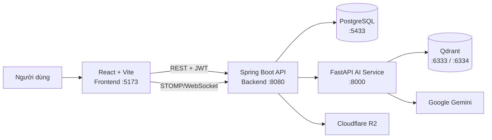
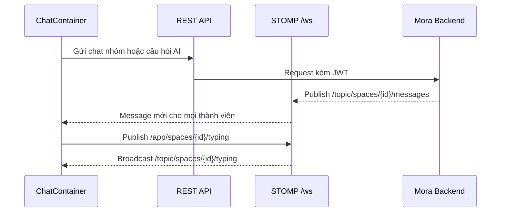

# Mora Frontend

Ứng dụng web cho Mora — nền tảng học tập có không gian cộng tác, tài liệu, chat hỗ trợ AI và khu vực quản trị/đánh giá chất lượng RAG.

## Vai trò trong hệ thống



Frontend giao tiếp với Backend qua REST API tại `/api`; token JWT được tự động gắn vào mỗi request. Với chat trong không gian, frontend dùng STOMP qua WebSocket để nhận tin nhắn và trạng thái đang nhập theo thời gian thực.

## Công nghệ

- React 19, TypeScript, Vite 8 và Tailwind CSS 4.
- React Router 7 cho định tuyến và route guard.
- Axios cho REST API; TanStack React Query cho dữ liệu bất đồng bộ.
- STOMP.js cho WebSocket; React Hook Form + Zod cho biểu mẫu.
- shadcn/ui, Base UI, Lucide và Recharts cho giao diện.

## Cấu trúc chính

```text
src/
├── components/  # Thành phần UI dùng lại
├── features/    # Logic theo nghiệp vụ: auth, chat, space, ...
├── layouts/     # MainLayout và AdminLayout
├── pages/       # Màn hình auth, người dùng và quản trị
├── providers/   # React Query và theme
├── routes/      # Router, ProtectedRoute, GuestRoute
├── services/    # API client và tích hợp HTTP
└── types/       # Kiểu dữ liệu dùng chung
```

Các route chính gồm đăng nhập/đăng ký, dashboard, hồ sơ, không gian học tập, tham gia qua lời mời và quản lý người dùng. Các trang được lazy-load; route quản trị yêu cầu quyền `ADMIN`.

## Chat trong không gian học tập

Mỗi không gian có hai loại tin nhắn, dùng chung lịch sử nhưng có luồng xử lý khác nhau:

| Loại | Cách gửi | Xử lý |
| --- | --- | --- |
| Chat nhóm | `POST /api/chat/space/message` | Backend lưu và phát ngay cho thành viên; không gọi AI. |
| Câu hỏi AI | `POST /api/chat/space` | Backend gọi AI Service theo kiến trúc RAG, rồi phát câu hỏi và phản hồi AI. |

`useSpaceChatHistory` tải lịch sử bằng React Query. Sau khi gửi thành công, các mutation làm mới cache `chat-history`; đồng thời `useSpaceSocket` nhận bản cập nhật realtime để các thành viên trong cùng space nhìn thấy message ngay.



Kết nối STOMP dùng endpoint `/ws`, gửi JWT qua header `Authorization`, tự reconnect sau 3 giây và dùng heartbeat hai chiều mỗi 4 giây. Client chỉ subscribe các topic `/topic/spaces/{spaceId}/messages` và `/topic/spaces/{spaceId}/typing`; Backend quyết định quyền truy cập. Message AI có thể chứa `citations`, `condensedQuestion`, `promptSent` và danh sách document đã chọn để UI hiển thị câu trả lời có nguồn.

Luồng agent, retrieval, fallback và cách tạo citation được mô tả chi tiết tại [kiến trúc chatbot của AI Service](../mora-ai/README.md#kiến-trúc-chatbot).

## Yêu cầu

- Node.js phiên bản LTS mới.
- Backend Mora đang chạy, mặc định tại `http://localhost:8080`.

## Cấu hình môi trường

Tạo file `.env` trong thư mục này khi Backend không ở địa chỉ mặc định:

```env
VITE_API_BASE_URL=http://localhost:8080/api
```

Nếu không đặt biến trên, ứng dụng cũng dùng giá trị mặc định `http://localhost:8080/api`. URL WebSocket được suy ra từ cùng host, vì vậy không thêm hậu tố `/api` vào host WebSocket.

## Chạy local

```bash
npm install
npm run dev
```

Vite sẽ in URL local (thông thường là `http://localhost:5173`).

Các lệnh hữu ích:

```bash
npm run lint     # kiểm tra ESLint
npm run build    # kiểm tra TypeScript và tạo bản production
npm run preview  # xem thử bản build
```

## Liên quan đến các service khác

- Cài và chạy hạ tầng, Backend tại [`../mora-backend/README.md`](../mora-backend/README.md).
- Cài và chạy AI Service tại [`../mora-ai/README.md`](../mora-ai/README.md).
- Không đặt API key, mật khẩu cơ sở dữ liệu hay secret trong frontend.
